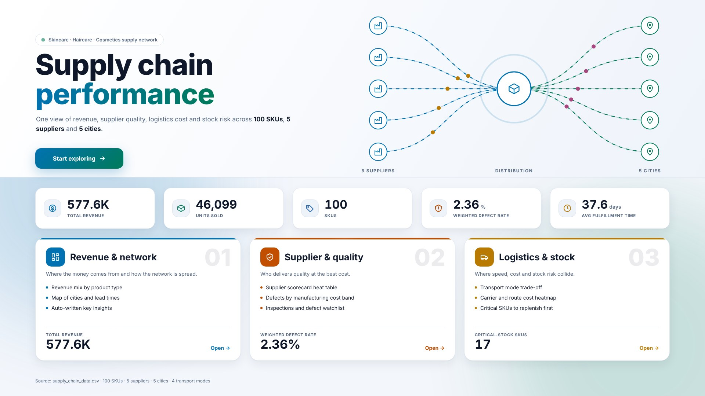
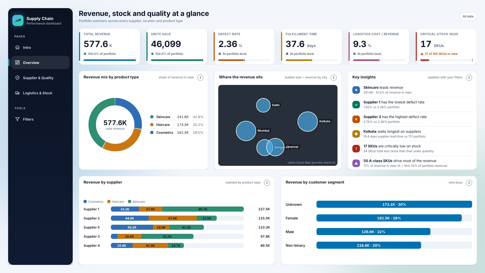
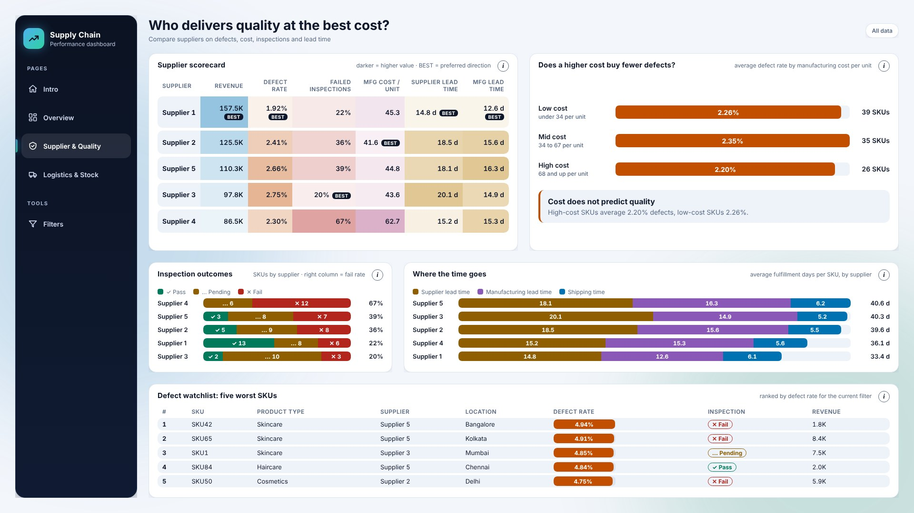
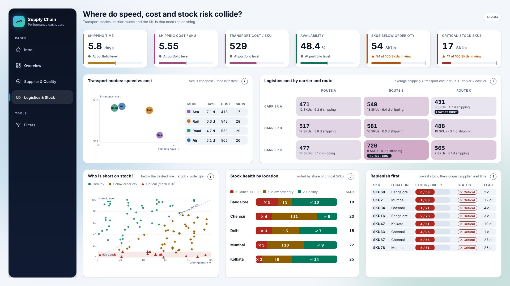
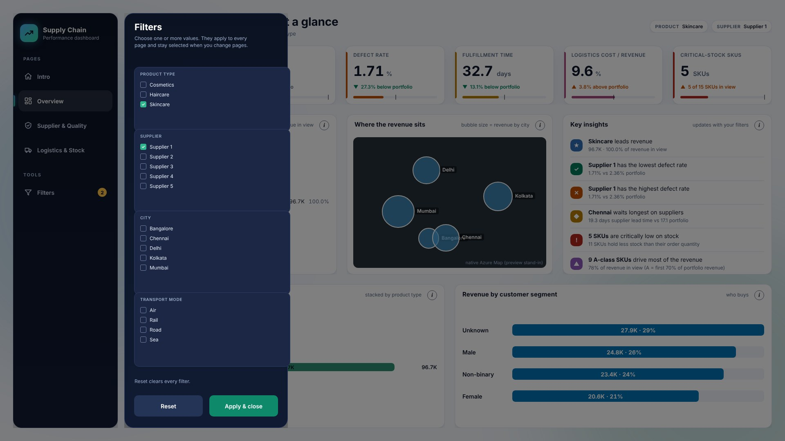

# Supply Chain Performance Dashboard

An interactive **Power BI** dashboard that turns a 100-SKU supply chain dataset into one story: where the revenue comes from, which suppliers deliver quality at the best cost, and where speed, cost and stock risk collide.

Every chart is drawn with **HTML, CSS and SVG** inside Power BI, so the visuals can animate, show rich hover tooltips and look like a product rather than a default report.

> Designed and built by **Ahmed Elgayar** (Data & BI Engineer) together with **Claude AI** (Anthropic). Claude generated the semantic model, the Power Query and DAX code, the HTML visuals and the report files. I defined the idea, reviewed the result and tested it in Power BI Desktop.

[Watch the 20-second tour](docs/dashboard-tour.mp4)



## What it shows

| Page | Question it answers | Highlights |
|---|---|---|
| **Intro** | What is this dashboard about? | Animated supply-chain network (5 suppliers, 1 hub, 5 cities), five headline numbers, cards that open each page |
| **Overview** | Where does the revenue come from? | KPI strip, revenue mix donut, native Azure Map of revenue by city, auto-written key insights, revenue by supplier and customer segment |
| **Supplier & Quality** | Who delivers quality at the best cost? | Supplier scorecard heat table, defect rate by manufacturing cost band, inspection outcomes, lead-time build-up, defect watchlist |
| **Logistics & Stock** | Where do speed, cost and stock risk collide? | Transport-mode trade-off, carrier x route cost heat map, stock vs order quantity, stock health by city, replenish-first queue |





*The images above are preview renders of the report layout.*

## Key findings from the data

- Skincare brings **41.8%** of the 577.6K revenue, and Supplier 1 handles **27%** of it.
- **36%** of SKUs failed inspection. Supplier 4 fails 67% of its SKUs.
- Paying more per unit does **not** lower defects: low, mid and high cost bands average 2.26%, 2.35% and 2.20%.
- Road is the fastest transport mode (4.7 days). Air is the most expensive yet slower than Road.
- **17** SKUs are critically low on stock, and Bangalore has the highest share of them (28%).

## Features

- **Left menu** on every page with navigation and a **Filters** item that shows how many filters are active.
- **Filters drawer** built with bookmarks: slides over the page, filters Product Type, Supplier, City and Transport Mode, and keeps the selection when you change pages.
- **Info icon** on every chart with a short "what it shows / how to read it" tooltip.
- **Hover tooltips** on bar segments, donut slices and map bubbles.
- Numbers printed **inside the bars** so charts can be read without hovering.
- Clean light theme, built on a 1920 x 1080 canvas.



## How it is built

**Data model** (star schema, import mode)

- Fact table `Supply Chain`: one row per SKU.
- Dimensions: `Product`, `Supplier`, `Location`, `Carrier`, `Transport Mode`, `Route`, `Customer Segment`, `Inspection`.
- Engineered in Power Query: Total Fulfillment Days, Logistics Cost, Stock Status, Defect Band, Fulfillment Speed, ABC class, price and cost bands, map coordinates.

**Visuals**

- The **HTML Content** custom visual (AppSource). Each chart is a DAX measure that returns an HTML string, so the layout, colors, animation and tooltips are fully controlled with HTML, CSS and SVG.
- A native **Azure Map** on the Overview page.
- The filters drawer, menu and info icons are bookmarks and buttons layered over the HTML.

**Tech stack:** Power BI Desktop (PBIP project: PBIR report + TMDL model), Power Query M, DAX, HTML, CSS, SVG, Claude AI.

## Run it

1. Clone the repo and open `SupplyChain.pbip` in **Power BI Desktop**.
2. If Desktop asks, add the **HTML Content** visual from AppSource.
3. Set the data path: *Home > Transform data > Manage parameters*, then point `Data File Path` to `supply_chain_data.csv` in this folder.
4. Refresh. With no filters you should see 100 SKUs, 577.6K revenue, 46,099 units sold and a 2.36% weighted defect rate.
5. The map needs Azure Maps to be enabled in your tenant (*File > Options > Security > Map and filled map visuals*).

## Project structure

```
SupplyChain.pbip              Power BI project file
SupplyChain.SemanticModel/    data model (TMDL): tables, relationships, measures
SupplyChain.Report/           report pages and visuals (PBIR)
supply_chain_data.csv         source data (100 SKUs)
docs/                         screenshots and the tour video
```

## About

Built by **Ahmed Elgayar**, Data & BI Engineer. The project also shows a workflow where an AI assistant writes the code and the engineer directs, reviews and tests it.
